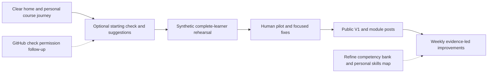
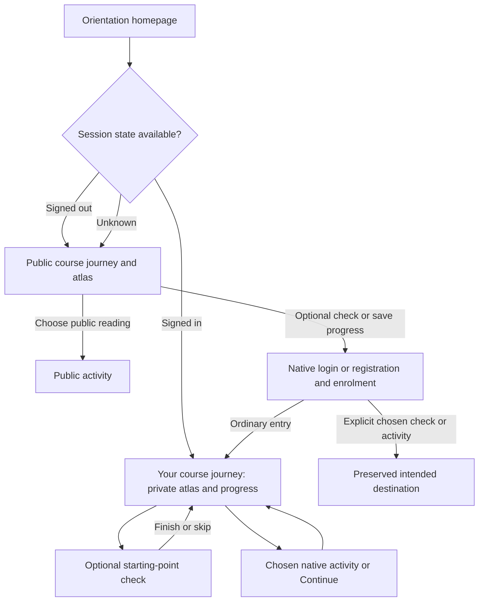

# Human AI Orientation: one plan from demo to public course

## Goal Capsule

Make the existing course easy to understand, join, use and return to; verify the complete experience with a small human pilot; then launch it with a course-and-module LinkedIn series.
This is the canonical forward plan for the outstanding work discussed through 23 October. The release-baseline plan is completed history, not a second active delivery plan.
The plan includes later ideas in a sequenced backlog without making them public-launch requirements.

**23 October course review:** the accepted activity-led atlas is implemented, but Finlay's learner walkthrough found unclear account state, competing destinations and hard-to-find activity details. Make **Your course journey** the central signed-in destination, retain the illustration and show actual completion on it. Promote the optional starting-point check into U8: **six statements, each with separate 1–5 understanding and can-do ratings**, followed by explained practice suggestions. The full personal skills/evidence map remains L2. Record subsequent feedback in [the course-review log](../reviews/course-review.md); use [the local-agent walkthrough](../qa/course-review-agent.md) to verify fixes.

Keep the decisions already made: use Moodle and the current demo checkout, retain three core activities plus the portfolio bridge and optional preparation, use experiential tasks/reflection, and accept Finlay's owner-reported paid Contabo backups for now.
Do not add a backup audit, restore exercise, new LMS, formal assessment programme or mandatory embedded AI.
Public enrolment must pass the existing email/recovery/support/operating checks before it opens. Preparing a launch does not send invitations, support replies or LinkedIn posts on Finlay's behalf.

## Product Contract

### What is already delivered

PR #8 is merged into main. Launch preparation is on `feat/public-launch` in draft PR #14: public offer/illustrated atlas, portfolio export/restore, native current-user progress and matching public AI context are implemented and deployed. Ordinary Moodle progress is still a separate plain list; the new personalised atlas and starting-point check are not implemented.
The [implementation record](../releases/2026-10-23-launch-implementation.md) records 57 passed synthetic checks and the separate owner-controlled genuine confirmation, enrolment, return and password-reset evidence. Those results describe the existing release; they are not verification of this review's proposed changes or human learning outcomes.
Broad registration remains closed under the exact-address pilot gate. Representative consenting mail checks, the human pilot, broader retention review and Finlay's launch decision remain. The competency framework remains an author draft; there is no saved competency-rating system yet.

### Requirements

| ID | Outcome |
| --- | --- |
| R1 | A visitor understands the offer, intended audience, practical takeaway, estimated time and one obvious next action. |
| R2 | A new learner can register, confirm their email, enrol in the intended course and arrive at a useful starting point; existing learners can sign in/recover access. |
| R3 | A signed-in learner sees their actual activity progress and a clear continue action after leaving and returning. |
| R4 | Each activity has an outcome, example, practical task, brief reflection, takeaway and next/prerequisite guidance; optional preparation stays optional. |
| R5 | Stable module identities and visible versions allow new or revised content without deleting answers, resetting completion or silently redefining historical completion. |
| R6 | Home/login discovery links expose a matching public AI course map, outcomes, versions and instructions, with a paste fallback and no access to private learner records. |
| R7 | Email, help, support handling, information-use guidance and proportionate operating checks are ready for public enrolment. |
| R8 | Three to five consenting people attempt the actual acquisition, practice, return and portfolio-reuse journey; blocking friction is corrected and evidence is reported honestly. |
| R9 | The full V1 is available at launch, with a drafted introduction and module-focused LinkedIn sequence, a readiness-based date and a release record. |
| R10 | GitHub Issues, CONTROL.md, learner/operator guidance and release evidence travel with each change; the existing CI permission task runs alongside product work. |
| R11 | The competency bank, non-linear map and all previously discussed improvements remain visible in this plan, with their review/design dependencies explicit. |
| R12 | Home makes account state and the next action clear; ordinary learner navigation consistently leads to Your course journey, with its illustrated atlas and discoverable activity details. |
| R13 | An optional native Moodle starting-point check presents six statements with two independently labelled 1–5 ratings each, plus uncertainty/skipping, and preserves dated attempts. |
| R14 | The private journey explains practice recommendations from the learner's own ratings; learners can override them, and ratings never award completion or proficiency. |
| R15 | A local browser agent can repeat public and synthetic learner checks, report actual friction and verify fixes from durable instructions without needing this chat. |

### Decisions carried forward

- KD1. Develop in the current demo checkout (session-settled: user-directed — chosen over an isolated integration checkout because only reviewer/test accounts exist). Preserve unrelated edits from other chats. Governs R3–R5 and R10.
- KD2. Accept the existing owner-reported Contabo backup provision (session-settled: user-directed — chosen over more backup audit/restore work for the current project stage). Keep source/runtime distinctions honest. Governs R7 and R10.
- KD3. Keep practical experience and reflection central (session-settled: user-directed — chosen over making formal assessments a launch dependency). Completion records practice, not mastery. Governs R4, R8 and R11.
- KD4. Include documentation/status impact in every plan and implementing PR (session-settled: user-approved — chosen over a documentation issue for every routine change). Governs R10.
- KD5. Use an activity-led orientation atlas with plain-language labels (session-settled: user-approved after reviewing the clickable preview). Map places represent the existing activities; tasks happen inside activities; competencies appear as practice outcomes and knowledge/performance self-checks. The six capability groupings and technical codes organise author records rather than define six new modules. Governs R1, R3, R4 and R11.
- KD6. Make the illustrated course journey the learner's main destination and simplify irrelevant learner navigation (session-settled: user-directed in the course-review voice note). Preserve the accepted Introduction / Your course section labels. Governs R1, R3 and R12.
- KD7. Use six statements with separate understanding and can-do ratings on a 1–5 scale (session-settled: user-directed, confirmed explicitly after the voice note). Use native Moodle Quiz; the bounded entry check is now active work rather than the entire later skills-map proposal. Governs R11, R13 and R14.

### Key learner flows and acceptance

- F1. Visitor: orientation splash → Explore your course → public journey; choose optional Find my starting point, an activity or sign-in/registration. Protected choices continue through confirmation/self-enrolment to the chosen journey/check/activity. Direct activity links retain their intended destination.
- F2. Returning learner: ordinary sign-in → Your course journey → actual progress/Continue → native Lesson resume or next incomplete activity. An explicit deep link takes precedence over the default journey landing. Completed activities remain revisitable.
- F3. Retained work: practise → download portfolio → leave → return/another device → restore downloaded backup → select useful context for a fresh AI task. Signing in alone must never imply that portfolio fields were saved to the account.
- F4. Course update: existing completed learner returns after a content change → prior records remain → current version/date and new optional material are visible. Historical course completion retains its original meaning.
- F5. Starting point: read purpose/storage explanation → six paired ratings or skip → finish → personal journey with one explained suggestion and all activities available. An interrupted attempt can resume; a retake leaves earlier attempts intact.
- F6. Account state: public page checks the current session → signed-in journey action, signed-out Sign in action, or honest state-unavailable fallback. Signing out/expiry removes personal presentation; public reading remains usable.
- AE1. A new visitor can explain the course's value and start without treating computer preparation as compulsory.
- AE2. Unconfirmed accounts cannot enter protected learner content. Invalid, repeated, delayed or stale confirmation/recovery links give a usable next step; welcome and return links do not lead to a dead end.
- AE3. Two accounts see only their own progress. Anonymous visitors retain public reading and no personalised status is invented from browser storage.
- AE4. Content sync run twice preserves original module IDs and learner evidence; adding content does not change historical completion definitions.
- AE5. A pilot learner can leave, return and reuse downloaded context; observed problems, assistance and limitations are recorded without publishing their private work.
- AE6. The atlas uses the five labels in the presentation specification below. Selecting a place reveals what the learner will do, keep and practise, with a correct public or authenticated activity link. A readable mobile/no-JavaScript list offers the same choices. Learner-facing labels contain no competency codes or Bloom references. All activities remain revisitable; entering later work offers existing/example context or a route to create what is missing.
- AE7. Without opening progress to investigate, a visitor can see the resolved account state. Your course journey appears consistently in public and native navigation. Ordinary learners do not need Dashboard/My courses to find the course; staff keep administrative access.
- AE8. Exactly six statements each have an understanding rating and a can-do rating. Neither defaults to a number. Not sure, Skip and unanswered responses remain unknown, with their response reasons preserved. Skipping the entire check still opens a usable journey.
- AE9. Low, high, mixed, unknown and retaken ratings produce the documented suggestions below, separately from real completion. Another learner cannot read those ratings or suggestions. No visit, high rating or quiz submission completes a course activity.
- AE10. A fresh synthetic learner registers from the visible interface, confirms in another browser, enrols, uses the check, completes practice and returns to saved progress without the test agent silently navigating around a broken step. Results identify the tested release and distinguish observed failures from usability judgement.

## Planning Contract

### Delivery order and ownership

| Milestone | Work | Owner | Exit evidence |
| --- | --- | --- | --- |
| A. Smooth first impression | U1 + U3 review changes: account state, consistent navigation, personal atlas, nearby details | Agent implements; Finlay reviews the first impression | Signed-out/new/returning paths are clear at desktop/mobile widths and without JavaScript |
| B. Useful starting suggestion | U8: native six-statement check and explained recommendations; U4 matching public guidance | Agent proves neutral native presentation, then implements | Twelve optional responses, skip/resume/retake and deterministic suggestions work privately without changing completion |
| B2. Complete learner rehearsal | U2 regression + U9 synthetic browser review | Agent checks isolated fixture/captured mail; Finlay checks revised experience | Full registration → check/skip → practice → leave/return/recovery evidence and reported friction |
| C. Small pilot | U5: remaining operating/mail gates, 3–5 people, focused fixes | Finlay selects/invites participants; agent supports QA and synthesis | Blocking problems resolved, evidence/limits recorded |
| D. Public V1 | U6: release, discoverability and post drafts | Agent prepares; Finlay chooses date and publishes posts | Whole course accessible, checks current, introduction ready |
| E. Improve weekly | Select up to three items from the later backlog | Finlay sets priorities using learner feedback | Need → change → verification recorded |
| Alongside A–D | U7: existing GitHub Actions permission follow-up | Owner-controlled publishing permission; agent installs/checks when available | Actual GitHub run, or clearly retained permission follow-up |

Use relative milestones until onboarding and pilot timing support a date. No new hard calendar deadline is invented. Pilot recruitment can be arranged while technical work proceeds, but participants test the real onboarding flow when ready.

### Technical decisions

- KTD1. Retain native Moodle email authentication, self-enrolment and completion. Introduce a small additive onboarding configuration tool; never rerun `scripts/seed-course.php` or `scripts/prepare-public.php` against the released course, because those reset trial settings and enrolment choices.
- KTD2. Keep anonymous `/journey` public. Use `/local/orientation/index.php` as the canonical private **Your course journey**, extending the existing local plugin and native completion APIs. Reuse the manifest and atlas presentation rather than creating another progress database. The static home/journey obtain only current-session account state from a same-origin Moodle endpoint; personal progress and ratings render only in the private journey. Do not infer a session from local storage.
- KTD3. Use one modest module manifest for stable slugs, destinations, outcomes, optional/required status, current versions and dates. Explicitly adopt existing Moodle IDs before changing display names: current sync identifies Pages by name, so an unguarded rename can duplicate them. Preserve the established three-activity/portfolio presentation.
- KTD4. Preserve the existing native Lesson's own resume behaviour and manual Page completion. Show current content versions and substantive update notes; do not promise a per-learner unseen-version history without storing it. New extensions stay optional until a separately recorded completion policy is agreed.
- KTD5. Extend the existing AI context source/builder and publish a new immutable context revision. If the JSON contract changes, version its schema separately. Update Caddy's exact release/schema allowlists in the same change. Public metadata remains descriptive and contains no private progress or account credentials.
- KTD6. Use existing automated checks plus focused new onboarding/progress tests. Test mail is captured without globally diverting live SMTP. Genuine confirmation/recovery receipt is an owner/consenting-recipient check; no automatic support reply or marketing mail is introduced.
- KTD7. The six competency areas group capabilities, not six new compulsory modules. Keep Bloom mappings and competency IDs in author references. U8 samples these areas with six plain-language statements; it does not assess all 18 bank competencies. The user's 1–5 paired format supersedes the older three-choice proposal for this entry instrument only. Full evidence/history/export presentation remains L2. Do not derive competence from visits, completion or self-ratings.
- KTD8. Register supported Moodle navigation/default-homepage hooks in the local plugin; retain `SESSION->wantsurl` precedence and the existing canonical signup gateway. Add Your course journey; hide Dashboard/My courses for ordinary orientation learners while retaining account, Help, sign-out and staff administration. Scope changes by course/capability; never redirect every `require_login()` or edit pinned core. Existing deep links/bookmarks continue to work.
- KTD9. Use native Quiz with twelve single-choice questions grouped into six labelled pairs, free navigation, no timer, unlimited fresh retakes, fixed item/answer order and no grade-to-pass or completion condition. Set quiz grade to zero and suppress learner-facing marks, correctness, right answers and grading feedback in attempt/review. First prove that neutral rendering and sensible mobile length are achievable in the isolated fixture. If native rendering still implies right/wrong, stop U8 publication and bring back that concrete limitation; navigation/atlas work can proceed.
- KTD10. Native attempts are authoritative. Store a versioned source instrument and stable statement/dimension/answer mappings; read the latest exactly FINISHED, non-preview, compatible attempt for the current authorised user. Resolve native answer order to mapped values, never grades/fractions or assumed answer IDs. Resume unfinished attempts; while unfinished, retain any previous finished recommendation with its date and a Resume check link. Abandoned attempts do not replace it. A new instrument version gets a new optional quiz and immutable mapping; preserve old quizzes/attempts, and show a dated earlier check with an invitation to retake rather than reinterpret it.
- KTD11. Public account-state response contains only signed-in/signed-out/unavailable state and fixed same-site actions, with private/no-store headers, no user ID/name/email, no ratings/progress, no caller-selected account and no CORS sharing. Exclude it and private journey responses from edge caches; handle back/forward/session expiry by revalidation and clearing enhanced state. On failure/no JavaScript show “Check sign-in / Your course journey” and retain public reading, never falsely assert signed out. Reads cause no enrolment or progress mutation; all writes use native ownership/capability/CSRF protections.
- KTD12. Local-agent parity is browser-based: the agent follows the same visible journey as a learner. Keep public AI context descriptive; add no private learner API or autonomous assessment agent. Run account/rating/completion mutations in the isolated fixture with captured mail, and publish only sanitised fictional evidence. New saved-rating wording in privacy/help must be reviewed before U8 is exposed to pilot users; earlier account/progress acceptance does not imply acceptance of undisclosed new storage.

### Journey routes and interface states

The public splash leads with **Human AI Orientation**, who it helps and the portable practical outcome. Retain “Make a useful start with AI” as supporting copy. Its primary action is **Explore your course** → `/journey`; a known signed-in visitor instead gets **Your course journey** → `/local/orientation/index.php`. The splash introduces the journey without duplicating the full interactive atlas. Public `/journey` owns the anonymous atlas and offers **Find my starting point** alongside an equally usable **Choose an activity** route. Account-required actions explain sign-in/registration and saved ratings before redirecting. Do not advertise unrestricted account creation while the pilot gate is active.

| State | What the learner sees / expected next action |
| --- | --- |
| Signed out | Visible Sign in and truthful account availability; public atlas/read route works; check explains account requirement |
| Signed in, not enrolled | Signed-in state and a clear native enrol/eligibility route; no false progress or completion |
| New enrolled learner | Your course journey, illustration, all five places, Not started states, optional check and ordinary Continue |
| Returning learner | Same atlas, actual native Completed / In progress / Not started where supported, Continue and dated self-rating suggestion |
| Baseline complete | Explicit completion of the original three core activities, Revisit choices and next goal; optional additions remain optional |
| Session unavailable/expired | Clear check-sign-in/recovery action; no stale personal data; chosen private destination resumes after valid sign-in |
| Administrator/reviewer | Journey available alongside required native administrative controls; no assumption that admin preview represents learner rendering |

On desktop, selection details sit beside the atlas with the title and Open this activity action visible. On narrow screens use adjacent expanding details for the selected place; do not reveal the action after the entire map/list. Keep selection, focus, accessible announcement and keyboard operation coherent. Without JavaScript, all descriptions/destinations remain readable in order. Retain the accepted artwork and native Introduction / Your course headings.

### Starting-point instrument and recommendation contract

The following is the implementation draft, to review in the real mobile/learner presentation. It is an orientation self-report sample, not a validated scale or evidence of the detailed competency bank.

| Statement ID | Learner statement | Author bank link | Suggested activity |
| --- | --- | --- | --- |
| SP1 | Choose a useful AI task and say what a good result would look like. | TASK-01–02 | Try AI on a useful task |
| SP2 | Give AI a clear instruction and clarify it when the response misses my meaning. | TALK-01–02 | Give AI the right background |
| SP3 | Choose helpful background and leave out unnecessary or private details. | CONTEXT-01 | Give AI the right background |
| SP4 | Check an AI result and decide what to use, change or reject. | CHECK-01–03 | Check a result and plan your next step |
| SP5 | Save useful context, find it again and adapt it for another task. | KEEP-01–03 | Save your context for next time |
| SP6 | Choose my next practice goal and a small step to work on it. | LEARN-01–03 | Check a result and plan your next step |

Each pair says **I understand this** and **I can do this**. Understanding anchors: 1 New to me; 2 I recognise it but need an explanation; 3 I understand the main idea; 4 I can explain when to use it; 5 I can explain its limits and apply the idea elsewhere. Can-do anchors: 1 I have not tried this; 2 I need step-by-step help; 3 I can do parts with help; 4 I can do it in a familiar task; 5 I can adapt it to a new task. Include **Not sure** and **Skip this rating**, with no preselected answer. Preserve explicitly unsure/skipped/unanswered reasons; all are unknown to the rule. These are subjective anchors, not calibrated competence levels.

Start with three native quiz pages containing two statement pairs each, descriptive section headings and free back/forward navigation. Explain six statements/twelve responses before starting; measure actual completion time in the pilot before advertising a duration. **Skip this check / Back to your course journey** is available before and during the attempt. Leaving mid-attempt does not silently submit it: resume is offered and unfinished answers do not drive new suggestions. A partial finished attempt is valid; unanswered items stay unknown. Submission returns through a visible journey action, not Dashboard. Retaking starts fresh without deleting prior attempts or course progress.

Rule version `starting-point-v1` selects one practice suggestion, not a hidden required sequence. For each statement assign the first matching priority: can-do 1–2 → priority 1; can-do 3 → priority 2; otherwise understanding 1–2 → priority 3; otherwise no candidate. Sort candidates by priority, numeric can-do (unknown last), numeric understanding (unknown last), then SP1–SP6 order. Recommend the first candidate's mapped activity with an explanation naming its relevant self-report and date. If that activity is already complete, say **Revisit**; retain ordinary Continue toward the next incomplete core activity separately. Every place remains open. Do not infer foundations needs from these six items; optional help remains available.

| Fixture input, other ratings 5 unless stated | Expected suggestion / explanation |
| --- | --- |
| SP1–SP6 understanding/can-do all 1 | Try AI on a useful task; explain SP1's low can-do self-report, no failure label |
| SP3 can-do 2, understanding 5 | Give AI the right background; explain practical confidence, preserve high reported understanding |
| SP4 understanding 1, can-do 5 | Check a result and plan your next step; explain reported understanding rather than invent low practical ability |
| SP5 can-do 3 and SP6 can-do 2 | Check a result and plan your next step (priority 1 before priority 2) |
| All ratings 4–5 | Ordinary next incomplete core activity; explain that the learner reported familiarity and can choose any practice |
| All Not sure / skipped, or no finished compatible attempt | Ordinary next incomplete core activity; explain that no starting-point suggestion is available, not low ability |
| Only SP5 can-do 2 answered in a finished partial attempt | Save your context for next time; do not fill other ratings |
| Completed context activity, SP3 can-do 2 | Revisit Give AI the right background suggestion plus distinct Continue; retain completion |
| All baseline activities complete and no candidate | Revisit any activity / choose next goal; do not invent another required module |
| New unfinished/abandoned retake after an earlier finished attempt | Earlier dated suggestion remains; unfinished attempt offers Resume, abandoned attempt does not replace prior results |

### System-wide impact and release boundaries

The change crosses static home/journey headers, Moodle login/default landing/navigation, signup continuation, native activity return links, Quiz attempts, private progress and public AI descriptions. Share atlas data/presentation while supplying private state only within the authenticated renderer. Preserve stable module IDs, native Page/Lesson semantics and the single generated `orientation-return-guidance` marker pair. Instrument publication must be additive and idempotent: compare version/hash before creating questions; never delete attempts to make quiz editing easier. Use supported quiz attempt APIs; `get_question_usage()` is tests-only, and the helper's “finished” lookup also includes abandoned attempts unless filtered explicitly.

Ship navigation/personal atlas first, then the optional check once the neutral-rendering proof passes. Keep the previous release available for a presentation rollback; disable/hide only the new optional check if needed, retaining its attempts. No core downgrade, course reseed or evidence deletion is a rollback. Refresh privacy/help and public context in the feature release; publish a new immutable AI revision/schema if its contract changes, retaining `2026-10-23.1` unchanged. Verify edge/private cache behaviour and session expiry with two accounts. Existing Contabo provision and broad-registration gate remain unchanged.

### Accepted atlas presentation and implementation reference

Use the [V1.2 learner presentation](../curriculum/competency-framework-v1.md#start-here-what-the-learner-sees) and the [clickable preview source](../prototypes/orientation-activity-atlas.html). The latter is the exact in-chat HTML fragment, preserved for implementation reference; it is not a production page and must not be deployed unchanged. It has no saved learner assessment and uses existing public activity links. Integrate reviewed copy and artwork into the supported public/Moodle content flow, using the module manifest and actual Moodle destinations.

| Atlas label | Learner takeaway | Existing destination/role |
| --- | --- | --- |
| Try AI on a useful task | A first result and a way to judge it. | `/first-task`; core activity |
| Give AI the right background | A reusable context brief. | `/preview` / existing Moodle Lesson; core activity |
| Save your context for next time | A reviewed personal context portfolio. | `/portfolio`; visible portfolio practice within the context activity |
| Check a result and plan your next step | A checked result, an improvement and a next-step plan. | `/check-and-continue`; core activity |
| Files, notes and AI basics — optional help | Files/notes the learner can find again and an available AI input route. | `/before-you-start`, `/notes`; supporting preparation |

The visitor's viewpoint is “What would you like to do with AI?” Select a place to see **You'll do**, **You'll keep**, **What you'll practise** and **Open this activity**. A plain-language **Check what I can do** disclosure can expose knowledge and practical checks; wording alone does not imply saved assessment. The preview's **Course-design view** explains example tasks, skills, knowledge checks and evidence for Finlay. Preserve that readable author reference in documentation; do not expose an author-only toggle to ordinary learners by copying the preview wholesale.

Paths suggest exploration without numbered gates or compulsory preparation. Offer a starting suggestion for newcomers and practical entry support for later activities. On small screens, present the same activity choices as readable cards/list. Use accessible real text, labelled controls, visible focus and sufficient touch targets over/beside illustration. Illustration supplies character; labels describe the actual activity. No workshop/library/lookout vocabulary is required to understand the map.

The signed-in journey uses the same illustration, activity names and actual Moodle completion, with a Continue action and U8's separate self-report suggestion. The full competency/evidence view remains later work. Keep the current three-core-activity completion contract, portfolio portability, fictional-example and copy/paste routes. Prototype checks remain historical evidence; they do not verify the proposed personalised journey or establish human usability.

## Implementation Units

### U1. Make the offer and next action clear

**Requirements:** R1, R4, R12; F1, F6, AE1, AE6–AE7. **Dependencies:** Existing deployed atlas; coordinate the account-state contract with U3.
**Files:** `content/home.html`, `content/course-map.json`, `scripts/build-journey.py`, generated public home/journey, `public/assets/site.css`, `public/assets/activity-atlas.js`, `tests/launch-entry.spec.cjs`.
**Approach:** Apply the route/state contract above: concise orientation splash, one journey CTA, visible account state and a clear public preview. Keep the full atlas on the journey rather than two competing interactive starts. Move desktop details beside the illustration and narrow-screen details near the selection; update focus, announcements and scrolling together. Preserve all five real destinations and arbitrary-entry examples. Retain truthful limited account availability and share-preview copy.
**Test scenarios:** Known signed-in/signed-out and failed/slow session probe; closed/open registration wording; desktop 1440px, 390px and 320px; keyboard selection/action and no-JavaScript list; all five destinations and later-activity entry. Expected: account state is honest, selected title/action agree and action is discoverable without scrolling beyond the whole atlas. No account is required for public reading.
**Documentation:** CONTROL.md, README, atlas authoring guide, review log and dated release evidence in the same PR.

**Writing-support convention:** use the shared Finlay’s Tips component for editable learning fields: voice-input reminders, reusable prompt starters and a side panel where space permits, with stacked/no-JavaScript alternatives. Keep it distinct from account-backed creations/navigation panels. Authoring and current verification belong in `docs/curriculum/finlays-tips.md` and the CR15 review record; no separate Moodle block or speech service is required.

### U2. Finish verified registration, enrolment and account help

**Requirements:** R2, R7; F1, AE2. **Dependencies:** U1's route/copy contract.
**Files:** New `scripts/configure-onboarding.php`, existing mail configuration helpers, `content/help.html`, `public/privacy.html`, `tests/onboarding.spec.cjs`, `tests/check-evidence.php`, appropriate test configuration.
**Approach:** Use supported Moodle account/enrolment APIs for the intended course and preserve manual accounts/enrolments. Provide status/check/configure-closed/open stages; keep registration closed until its email, recovery, support and operating receipt is recorded. Configure supported abuse controls and failed-login handling. Explain confirmation/resend, duplicate/existing accounts, missing email, welcome and recovery, including confirmation opened in another browser. Keep return destinations on the intended site. Draft accurate account information-use, deletion/help and support handling for Finlay's review; do not invent retention promises or a response SLA.
**Review delta:** Existing owner-controlled confirmation/recovery is complete; do not request it again as if untested. Preserve the signup gateway and its POST-to-GET continuation when default login landing changes. Extend regression coverage to chosen journey/check/activity destinations; U9 owns the fresh synthetic walkthrough. Representative consenting recipients and broader-readiness decisions remain outstanding.
**Verification:** Select an isolated native Moodle fixture with captured test mail before automating account checks. Cover account confirmation, unconfirmed access denial, existing/duplicate account and already-enrolled routes, invalid/stale/repeated links, recovery in a fresh session, and deep-link return. Verify genuine delivery to representative consenting recipients before broad enrolment; earlier delivery to Finlay alone is not that evidence. Re-running configuration is idempotent and does not release unrelated queued mail.
**Documentation:** Email/support guide, deployment guide, privacy/help copy, CONTROL.md and a dated release receipt; finish remaining issue #4 scope with evidence.

### U3. Provide actual progress, continue and safe course updates

**Requirements:** R3–R5, R12; F2–F4, F6, AE3–AE4, AE6–AE7. **Dependencies:** Existing U2 identity/enrolment contract and U1's shared atlas layout.
**Files:** Existing `content/course-map.json`, `moodle/local/orientation/index.php`, `lib.php`, `classes/catalogue.php`; proposed plugin `state.php`, `db/hooks.php` and callback/rendering classes; deployment tooling, `scripts/sync-journey.php`, `scripts/build-journey.py`, `tests/progress.spec.cjs` and `tests/onboarding.spec.cjs`.
**Approach:** Replace the independent plain progress list with Your course journey, sharing atlas data/presentation and applying current-user native completion privately. Reuse catalogue stable-ID resolution, Page manual completion and Lesson resume. Keep ordinary Continue as first incomplete baseline activity, with explicit unavailable/all-complete handling. Support plain text states, download/restore guidance and current content versions. Add the minimal observational account-state endpoint and supported native navigation/default-homepage hooks described in KTD8/KTD11; preserve activity `wantsurl`, account/recovery links, staff controls and Introduction / Your course headings. Never substitute a request parameter for current-user identity.
**Test scenarios:** A and B have different native completion; each fresh context sees only its own atlas. Ordinary login lands on journey; chosen Lesson/check/signup routes retain intent. Learner nav is coherent across enrolment, quiz, Lesson, Page and account routes, while administrator navigation remains. Sign-out/expiry/back/reload remove stale personal display; probe failure neither redirects nor changes session continuation. Page completion moves Continue; visits/high ratings do not. Hidden baseline yields an unavailable message rather than false completion. Repeat sync preserves IDs, answers, attempts and completion. Restore downloaded portfolio on another browser without claiming account-backed portfolio fields.
**Documentation:** Progress/onboarding operations, module authoring, reproduction/deployment, learner saving guidance, CONTROL.md, review log and release evidence.

### U4. Align public AI navigation and course metadata

**Requirements:** R6; F1–F4. **Dependencies:** U3's stable module manifest; can prepare alongside U2–U3.
**Files:** `content/ai/course-context.json`, `scripts/build-ai-context.py`, generated `public/ai/` files, `deploy/Caddyfile`, landing/login instructions, `tests/public.spec.cjs`.
**Approach:** Describe the module map, outcomes, versions, public destinations, signed-in progress destination and account limitations from the reviewed source. Link the human-readable guide from home and login. Retain inspectable Markdown and paste/no-browsing routes. Publish changed immutable context and any schema revision with matching allowlists; old releases remain readable.
**Review delta:** Describe the canonical journey and optional self-rating purpose after U8. Public guidance may explain the rule, never expose individual answers/recommendations or invite an agent to fill ratings for the learner. Preserve the pinned `2026-10-23.1` release and earlier schemas.
**Verification:** Manifest/schema match, actual external fetch of current and pinned context, working module links, JavaScript-free reading and private-path denial. Metadata neither discloses another user's progress nor grants an agent permission to sign in or mark completion.
**Documentation:** AI-context design/authoring guide and current release/version notes.

### U5. Check operating readiness and run the human pilot

**Requirements:** R7–R8, R12–R15; AE5, AE7–AE10. **Dependencies:** U1–U4 review changes, U8 and U9 evidence ready for the acquisition/return walkthrough.
**Files:** `docs/pilot/PROTOCOL.md`, existing public/native tests, `docs/operations/email-and-support.md`, `public/privacy.html`, CONTROL.md and dated release/pilot synthesis; private observations under ignored `trial/pilot/`.
**Approach:** Extend the existing pilot protocol from the new homepage through verification/enrolment, meaningful practice, leaving, returning, portfolio retrieval and reuse. Finlay reviews the actual course and operating wording, selects/invites 3–5 people and decides any quotation consent. Include phone/app switching, keyboard and available assistive-technology checks. Agent rehearsals remain labelled synthetic. Fix blocking onboarding, saving, access and usability problems; select at most three further improvements from evidence. Keep the accepted backup position unchanged.
**Review focus:** Observe the first landing without coaching; can the person tell their account state, find the journey, interpret completion versus ratings, choose/check/skip a starting point and locate the selected activity action? Record actual check duration and whether suggestions help. Finlay's current walkthrough is owner feedback, not the 3–5-person pilot.
**Verification:** Record actual invitation/participation and assistance honestly; do not treat a prepared protocol or synthetic pass as human participation. Confirm email/recovery, private-route boundaries, support contact/approval handling and actionable learner feedback. If participants are unavailable, report a limited beta honestly rather than claim the public-launch gate passed.
**Documentation:** Private observations, sanitised synthesis, issue #5 outcome and issue #6 priorities, current operating/help copy and release evidence.

### U6. Release V1 and prepare the LinkedIn series

**Requirements:** R9–R10. **Dependencies:** U5's readiness findings and fixes.
**Files:** New `docs/launch/linkedin-series.md`, dated release record, README/case study, CONTROL.md, public/share metadata and `deploy/Caddyfile` where appropriate.
**Approach:** Choose the public date from readiness. Make the entire V1 available together, then promote individual parts. Review the prototype-wide `noindex,nofollow` policy: allow discovery for intended public content while keeping login/account/private routes protected. Draft the five posts below with useful examples and working destinations. Finlay reviews/publishes posts; no automatic LinkedIn send is authorised. Update the LMS case study with actual evidence and remaining limits.
**Verification:** Fresh learner walkthrough after release, public and signed-in links, share-preview text and public/private discovery rules. No claim of learning gain without evidence. Documentation/copy checks suffice for posts; no prose-only automated tests.
**Documentation:** Release state, remaining work, actual launch date and public evidence; close umbrella issue #9 only after its acceptance evidence is linked.

### U7. Enable the prepared GitHub checks when permission is available

**Requirements:** R10. **Dependencies:** Owner-controlled workflow publishing permission; independent of product milestones.
**Files:** Existing `docs/operations/course-checks.workflow.yml`, eventual `.github/workflows/course-checks.yml`, `docs/REPRODUCING.md`, CONTROL.md.
**Approach:** Reuse the prepared build/drift/support/portfolio workflow; no new test framework or production secrets. The existing OAuth login lacks workflow scope and the connected app/SSH route could not publish it on 23 October. Do not repeat failed routes or request tokens in chat; use an authorised owner login when available. Product work continues with observed local checks meanwhile.
**Verification:** Require an actual successful GitHub run before calling CI active, including the new portable checks that are suitable for a clean runner. Native account tests need an explicit isolated fixture, not production credentials.
**Documentation:** Keep issue #10 and setup instructions honest; close only after run evidence exists.

### U8. Add the optional native starting-point check and explained suggestions

**Requirements:** R11, R13–R14; F5, AE8–AE9. **Dependencies:** U3's canonical private journey; can prove neutral quiz presentation alongside U1/U3. U4 metadata follows the final route.
**Files:** Proposed `content/starting-point.json` versioned instrument, additive `scripts/publish-starting-point.php`, local plugin attempt-reader/recommendation classes, `tests/starting-point.spec.cjs`; existing competency framework, privacy/help and native course manifest/catalogue integration where needed.
**Approach:** First create a tiny isolated native proof using a real synthetic learner, grade zero, neutral display/review and paired mobile layout. Use native deferred-feedback behaviour with learner marks/correctness/right-answer/feedback disabled; verify summary/review/gradebook as well as the attempt. Then publish the six pairs/anchors above, fixed choices and immutable version mapping, with no baseline completion requirement. Store answers only in native attempts. Idempotent publication compares version/hash before supported question creation; publish a new optional quiz for changed instruments and retain earlier attempts. Read exactly finished non-preview attempts using supported attempt/slot/question APIs and per-attempt answer order mapping. Apply `starting-point-v1` with date, explanation, learner override and separate Continue. Filter unavailable activities: show the relevant practice need as unavailable, offer available alternatives/Help and retain the baseline unavailable warning; never emit a dead link or silently redefine required work.
**Test scenarios:** All rows of the recommendation table, both dimensions independently, no preselected ratings, uncertainty/skip/unanswered, whole-check skip, partial finish, interrupted resume, fresh retake, older/incompatible instrument and changed answer order. A high rating never marks complete; low rating of completed work offers Revisit. Two accounts cannot read/act on each other's attempts via forged IDs. Native gradebook/review never presents a mark, pass/fail or right/wrong answer to ordinary learners. Run publication twice and compare original module/evidence fingerprints; attempts survive a new version and rollback of presentation.
**Verification gate:** Do not expose the check to pilot/public learners until neutral presentation, current-user boundaries and accurate saved-rating privacy/help wording are verified and Finlay reviews that new wording. If supported native settings cannot meet neutrality, stop only U8 publication and report the concrete limitation; no unrequested custom question type/core patch.
**Documentation:** Update competency draft/design brief to distinguish this six-pair instrument from full skills tracking; progress/onboarding/authoring guides, privacy/help, CONTROL.md, review log and dated synthetic evidence. Keep retention review before broader launch.

### U9. Verify the revised experience as a synthetic learner and hand it off

**Requirements:** R2–R4, R12–R15; F1–F6, AE1–AE3, AE6–AE10. **Dependencies:** U1/U3/U8 integration; U2/U4 routes current.
**Files:** `docs/qa/course-review-agent.md`, `docs/qa/course-review-report-template.md`, `docs/reviews/course-review.md`, `docs/REPRODUCING.md`, existing focused browser suites and a new dated release receipt. Raw artifacts stay under ignored `trial/course-review/<run-id>/`.
**Approach:** Run the portable checklist against the identified release. Begin from learner-visible instructions, recording any unexpected destination/unclear action without admin repairs. On production run public reading only by default; use fresh labelled synthetic users and captured mail in the isolated native fixture for signup/confirmation/enrolment/check/practice/recovery. Test a second account and fresh contexts; stale suspended historical QA users/owner passwords are unsuitable. Keep captured fixture receipts confined to that fixture. Reuse Playwright rather than add a new automation platform.
**Test scenarios:** Anonymous desktop/mobile/keyboard/no-JavaScript; signed-in/new/returning/all-complete/unavailable states; direct and generic registration; confirmation in another context; interrupted/partial check and recommendations; Page completion/Lesson resume; leave/return; captured recovery and invalid/expired links; two-user isolation and sign-out cache clearing. Acceptance is the table/report in the handoff, not just a successful HTTP response.
**Verification:** Report functional failures separately from agent usability concerns, not-tested cases and passed scenarios; link the actual fix and recheck before calling feedback resolved. Finlay reviews the revised landing/journey before human pilot. Do not claim synthetic usability proves comprehension, learning or physical-device/assistive-technology performance.
**Documentation:** Update the review log and CONTROL.md with what changed, actual evidence and remaining limits; comment on existing launch issue #9 with links, retaining #4/#5/#6/#10 scope. No duplicate routine documentation issue and no closure by planning.

## Release and communication schedule

Let T0 be the public launch date agreed after U5, not an assumed deadline. Draft these while building; publish only after their destinations are live.

| Time | Post | Useful reader action |
| --- | --- | --- |
| T0 | Why Finlay made the course, who it helps, what learners take away | Start the full free course |
| T0 + 3 days | Activity 1: do one worthwhile thing with AI | Choose a small task and a checkable result |
| T0 + 7 days | Activity 2: give useful context | Improve a brief and inspect what changes |
| T0 + 10 days | Portfolio spotlight within activity 2 | Keep and selectively reuse reviewed context |
| T0 + 14 days | Activity 3: check, improve and choose what comes next | Verify a result and choose a next goal |

These are proposed editorial intervals, not scheduled posts or a drip-access restriction. Review the course weekly after pilot/launch; choose no more than three improvements per cycle.

## Later improvements in this same plan

These remain visible work, not hidden launch dependencies. Detail the selected item here before implementing it; keep one canonical plan rather than opening competing roadmaps.

| ID | Workstream | Next decision or dependency |
| --- | --- | --- |
| L1 | Competency bank, page objectives and plain-language self-checks | Use `docs/curriculum/competency-framework-v1.md`, currently V1.2: six author capability groupings, 18 core/four optional foundations, paired knowledge/capability outcomes and Bloom alignment. The activity-led atlas is accepted and moves into U1/U3; choosing between atlas/constellation/garden is no longer a prerequisite for navigation. Refine full wording/density/uncertainty choices, finish the resource inventory and pilot the objective/can-do pattern on `/notes`. Codes remain internal; no validated scale or saved assessment is assumed. |
| L2 | Full personal skills/evidence map, richer assessment history/export and engagement records | The bounded six-pair native starting-point check and saved attempts move to U8 now. Detailed per-competency evidence, history visualisation/export and optional knowledge/performance tasks remain here after L1 review. Keep engagement, completion, self-report, task evidence and evaluation distinct; optional AI feedback cannot award competence or change completion. |
| L3 | Glossary, workspace guides and supporting resources | Review existing glossary proposal; add real annotated OS/app screenshots with text alternatives, public/Moodle links and relevant can-do/objective links. Verify provider memory/project-context claims, curated pathways and optional AI Hero reading before learner-facing use. |
| L4 | Day of AI side quests and optional email questions | Start, if selected, with one original untimed question, explanation and practice link. Check exact third-party rights before adaptation. Personalised results need explicit answer storage/identity; a link visit must not submit an answer. |
| L5 | Reminders, refreshers and digests | Require opt-in/frequency/pause/unsubscribe decisions and reliable return links before sending. Do not equate enabling SMTP with consent for a reminder campaign. |
| L6 | Demonstrations, richer input and optional challenges | One short captioned/transcribed demonstration; experienced-user challenges; voice/images/live camera and accessible alternatives; browser/computer-action practice only where useful. |
| L7 | Reporting and course expansion | Separate real/test accounts; use a modest progress/help/usefulness report to select improvements. Expand toward the earlier ten-session outline from actual need rather than making ten sessions a launch obligation. |
| L8 | Account-backed portfolios, certificates and embedded assistance | Consider only if learners value them and privacy/portability/operating cost are acceptable. Include personalisation and further provider/resource pathways here; the separate human–agent curriculum-design programme remains outside this project. |
| L9 | Guided portfolio steps, visible draft/progress and optional side preview | Follow CR12 in the course-review log: test the smaller first-pass briefing and clearer questions, then choose a compact interaction that shows the learner's own emerging documents without making every field compulsory. Preserve existing drafts, backup keys, selective sharing and no-JavaScript use. This UI is not delivered by the role-play copy revision. |

## Verification Contract

Retain the existing build/drift/support/portfolio and native checks; extend focused entry/onboarding/progress suites and add the U8 starting-point suite. During implementation use `npm run build`, `npm run check:public`, `npm run test:entry`, `npm run test:metadata`, `npm run test:portfolio` and `npm run test:support` as applicable, following `docs/REPRODUCING.md` for isolated ports/configuration and generated-drift checks. Native `npm run test:onboarding` and `npm run test:progress` require the isolated fixture procedures in onboarding/progress operations, captured mail and fresh synthetic users; never target production credentials. Add a focused native starting-point test configuration/script in U8 rather than assume it already exists. Planning itself does not run these checks.
Use synthetic captured mail/test accounts for automated verification, then record genuine consented mail and pilot observations separately. Never reroute all live mail to make a test pass.
Preserve source/generated pairs, module IDs and original evidence through supported APIs. Review public/private routing and credentials before publication.
Update the affected learner, author and operator guidance, CONTROL.md and issue/release evidence in each implementing PR; no separate documentation issue per routine edit.
Do not reset/reseed the course, add formal assessments, publish private learner work or repeat backup experiments as incidental verification.
For this review batch, satisfy AE6–AE10 and every U1/U3/U8/U9 scenario, check privacy/cache/attempt ownership, and repeat native publication/evidence preservation. Record the tested commit/environment, not an inherited pass count. New failures get focused regression coverage where meaningful; prose-only plan/guide changes need review and link/diff checks rather than application test runs.

## Definition of Done

The public-launch slice is complete when R1–R10 and R12–R15's product and pilot outcomes are evidenced, the full V1 can be joined and resumed, and launch/post materials are ready for Finlay to publish.
The CI permission task may remain explicitly open without blocking the course; local checks and remote CI must never be conflated.
Later items L1–L9 are consolidated and sequenced, not falsely marked implemented; the competency/map draft remains subject to review.
The current course is self-contained, retains earlier records and portable work, and has an operating owner, a useful help path and a dated improvement/release trail.
The course-review batch is ready for Finlay's recheck when the home states the account/next action honestly, Your course journey is the illustrated personal hub, selected activity details/actions are easy to find, the six paired ratings and optional skip work neutrally, and recommendations are private/explained/overridable. A fresh synthetic full journey and two-user preservation checks must have actual evidence. Until then, the review log says Planned rather than Fixed.

## Open Decisions and Sources

No unresolved product question blocks starting navigation/atlas implementation. Deferred review gates: Finlay's new saved-rating wording before exposing U8; broader retention/support position and representative mail before public enrolment; pilot participants/consent; public date/post copy; full competency/evidence map design before L1/L2. The six-pair count/format is settled. Instrument wording/anchors and deterministic rules above are the implementation draft; review their actual presentation rather than reopening the user-selected format.
GitHub workflow permission is an external setup dependency, not an unresolved choice of test framework. The accepted Contabo provision is unchanged.

Tracking: [#9 launch umbrella](https://github.com/drfinlaymccall/human-ai-orientation/issues/9), [#4 remaining email/onboarding](https://github.com/drfinlaymccall/human-ai-orientation/issues/4), [#5 pilot](https://github.com/drfinlaymccall/human-ai-orientation/issues/5), [#6 evidence-led improvements](https://github.com/drfinlaymccall/human-ai-orientation/issues/6), [#10 CI permission](https://github.com/drfinlaymccall/human-ai-orientation/issues/10). These stay as focused work items under this plan rather than being duplicated or closed by planning.
Repository grounding: `AGENTS.md`, `CONTRIBUTING.md`, `CONTROL.md`, `docs/design-brief.md`, `docs/curriculum/competency-framework-v1.md`, `docs/curriculum/public-ai-context.md`, `docs/pilot/PROTOCOL.md`, `docs/operations/email-and-support.md`, `scripts/sync-journey.php`, and `deploy/Caddyfile`.
Native mechanism references, checked 23 October 2026: [Moodle 4.5 email registration](https://docs.moodle.org/405/en/Email-based_self-registration), [self-enrolment](https://docs.moodle.org/405/en/Self_enrolment), [activity completion](https://docs.moodle.org/405/en/Activity_completion). TinyFish was blocked on these pages; the standard web reader retrieved the official documentation.
Course-review grounding: Finlay's 23 October voice-note transcription and explicit six-statement/two-rating reply; existing issue bodies plus #6/#9 comments checked (no dedicated competency-quiz issue found). [Moodle 4.5 Quiz settings](https://docs.moodle.org/405/en/Quiz_settings) covers navigation/review/attempt options; [Building Quiz](https://docs.moodle.org/405/en/Building_Quiz) covers grouping and warns about changing attempted questions. TinyFish Fetch was bot-blocked; the standard web reader retrieved both official pages. API decisions are grounded in pinned `vendor/moodle/lib/classes/hook/navigation/primary_extend.php`, `user/classes/hook/extend_default_homepage.php`, `login/lib.php`, `mod/quiz/lib.php`, `mod/quiz/classes/quiz_attempt.php` and `question/type/multichoice/question.php`. No new third-party quiz dependency is assumed.
