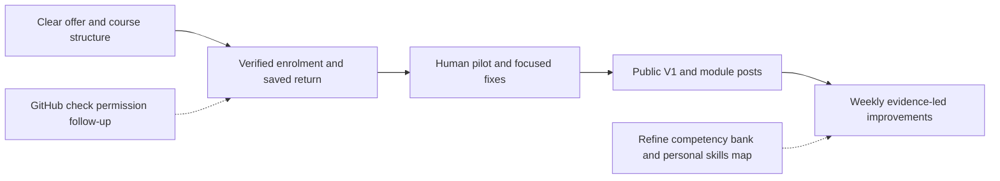

# Human AI Orientation: one plan from demo to public course

## Goal Capsule

Make the existing course easy to understand, join, use and return to; verify the complete experience with a small human pilot; then launch it with a course-and-module LinkedIn series.
This is the canonical forward plan for the outstanding work discussed through 23 October. The release-baseline plan is completed history, not a second active delivery plan.
The plan includes later ideas in a sequenced backlog without making them public-launch requirements.

**23 October map handoff:** Finlay accepted the activity-led atlas preview in **HOC course map visualisation and competencies** and requested its inclusion in **HOC Forward plan**. Incorporate its clear activity labels and non-linear navigation in U1, and reuse those same destinations for U3's progress view. The source and acceptance details are below. Saved competency ratings, the starting-point quiz and a personal skills map remain L2 work; they are not required to deliver the atlas navigation.

Keep the decisions already made: use Moodle and the current demo checkout, retain three core activities plus the portfolio bridge and optional preparation, use experiential tasks/reflection, and accept Finlay's owner-reported paid Contabo backups for now.
Do not add a backup audit, restore exercise, new LMS, formal assessment programme or mandatory embedded AI.
Public enrolment must pass the existing email/recovery/support/operating checks before it opens. Preparing a launch does not send invitations, support replies or LinkedIn posts on Finlay's behalf.

## Product Contract

### What is already delivered

PR #8 is merged into main. The public journey, portfolio export/restore, native Moodle progress, reviewer-account recovery, reviewed support workflow, source/design history and LMS case study exist.
The 23 October baseline passed build/drift checks, six support tests and eight portfolio browser tests. Those are synthetic functional results; they do not establish human learning outcomes.
Public registration remains closed. The competency framework is a local draft, not a shipped learner-record system. Finlay has accepted the activity-led orientation-atlas direction and clickable preview for inclusion in this plan; production artwork, activity entry support and deployment still need implementation and verification.

### Requirements

| ID | Outcome |
| --- | --- |
| R1 | A visitor understands the offer, intended audience, practical takeaway, estimated time and one obvious next action. |
| R2 | A new learner can register, confirm their email, enrol in the intended course and arrive at a useful starting point; existing learners can sign in/recover access. |
| R3 | A signed-in learner sees their actual activity progress and a clear continue action after leaving and returning. |
| R4 | Each activity has an outcome, example, practical task, brief reflection, takeaway and next/prerequisite guidance; optional preparation stays optional. |
| R5 | Stable module identities and visible versions allow new or revised content without deleting answers, resetting completion or silently redefining historical completion. |
| R6 | Home/login discovery links expose a matching public AI course map, outcomes, versions and instructions, with a paste fallback and no access to private learner records. |
| R7 | Email, help, support handling, information-use guidance and proportionate operating checks are ready for public enrolment. |
| R8 | Three to five consenting people attempt the actual acquisition, practice, return and portfolio-reuse journey; blocking friction is corrected and evidence is reported honestly. |
| R9 | The full V1 is available at launch, with a drafted introduction and module-focused LinkedIn sequence, a readiness-based date and a release record. |
| R10 | GitHub Issues, CONTROL.md, learner/operator guidance and release evidence travel with each change; the existing CI permission task runs alongside product work. |
| R11 | The competency bank, non-linear map and all previously discussed improvements remain visible in this plan, with their review/design dependencies explicit. |

### Decisions carried forward

- KD1. Develop in the current demo checkout (session-settled: user-directed — chosen over an isolated integration checkout because only reviewer/test accounts exist). Preserve unrelated edits from other chats. Governs R3–R5 and R10.
- KD2. Accept the existing owner-reported Contabo backup provision (session-settled: user-directed — chosen over more backup audit/restore work for the current project stage). Keep source/runtime distinctions honest. Governs R7 and R10.
- KD3. Keep practical experience and reflection central (session-settled: user-directed — chosen over making formal assessments a launch dependency). Completion records practice, not mastery. Governs R4, R8 and R11.
- KD4. Include documentation/status impact in every plan and implementing PR (session-settled: user-approved — chosen over a documentation issue for every routine change). Governs R10.
- KD5. Use an activity-led orientation atlas with plain-language labels (session-settled: user-approved after reviewing the clickable preview). Map places represent the existing activities; tasks happen inside activities; competencies appear as practice outcomes and knowledge/performance self-checks. The six capability groupings and technical codes organise author records rather than define six new modules. Governs R1, R3, R4 and R11.

### Key learner flows and acceptance

- F1. Visitor: landing page → preview or start → register → email confirmation → course self-enrolment → chosen activity. Existing accounts and direct module links reach sign-in/enrolment and return to the intended course destination.
- F2. Returning learner: sign in → actual progress → continue → use the native Lesson resume route or next incomplete activity. Completed activities remain available to revisit.
- F3. Retained work: practise → download portfolio → leave → return/another device → restore downloaded backup → select useful context for a fresh AI task. Signing in alone must never imply that portfolio fields were saved to the account.
- F4. Course update: existing completed learner returns after a content change → prior records remain → current version/date and new optional material are visible. Historical course completion retains its original meaning.
- AE1. A new visitor can explain the course's value and start without treating computer preparation as compulsory.
- AE2. Unconfirmed accounts cannot enter protected learner content. Invalid, repeated, delayed or stale confirmation/recovery links give a usable next step; welcome and return links do not lead to a dead end.
- AE3. Two accounts see only their own progress. Anonymous visitors retain public reading and no personalised status is invented from browser storage.
- AE4. Content sync run twice preserves original module IDs and learner evidence; adding content does not change historical completion definitions.
- AE5. A pilot learner can leave, return and reuse downloaded context; observed problems, assistance and limitations are recorded without publishing their private work.
- AE6. The atlas uses the five labels in the presentation specification below. Selecting a place reveals what the learner will do, keep and practise, with a correct public or authenticated activity link. A readable mobile/no-JavaScript list offers the same choices. Learner-facing labels contain no competency codes or Bloom references. All activities remain revisitable; entering later work offers existing/example context or a route to create what is missing.

## Planning Contract

### Delivery order and ownership

| Milestone | Work | Owner | Exit evidence |
| --- | --- | --- | --- |
| A. Clear front door | U1: offer, activity-led atlas and staged calls to action | Agent builds from the accepted preview; Finlay reviews the course promise and final presentation | Clear mobile/keyboard/no-JavaScript atlas and activity-detail route from homepage to public course/start |
| B. Real enrolment and return | U2–U4: verified onboarding, saved progression, upgrade/agent metadata | Agent builds/checks; Finlay verifies representative mail receipt and operating wording | Register/confirm/enrol/leave/return journey works with preserved records |
| C. Small pilot | U5: readiness review, 3–5 people, focused fixes | Finlay selects/invites participants; agent supports QA and synthesis | Blocking problems resolved, evidence/limits recorded |
| D. Public V1 | U6: release, discoverability and post drafts | Agent prepares; Finlay chooses date and publishes posts | Whole course accessible, checks current, introduction ready |
| E. Improve weekly | Select up to three items from the later backlog | Finlay sets priorities using learner feedback | Need → change → verification recorded |
| Alongside A–D | U7: existing GitHub Actions permission follow-up | Owner-controlled publishing permission; agent installs/checks when available | Actual GitHub run, or clearly retained permission follow-up |

Use relative milestones until onboarding and pilot timing support a date. No new hard calendar deadline is invented. Pilot recruitment can be arranged while technical work proceeds, but participants test the real onboarding flow when ready.

### Technical decisions

- KTD1. Retain native Moodle email authentication, self-enrolment and completion. Introduce a small additive onboarding configuration tool; never rerun `scripts/seed-course.php` or `scripts/prepare-public.php` against the released course, because those reset trial settings and enrolment choices.
- KTD2. Keep anonymous `/journey` public. Put authenticated progress in a supported, repository-owned Moodle local plugin using current-user login/capability checks and native completion APIs. Do not guess session state in static JavaScript or create a second progress database.
- KTD3. Use one modest module manifest for stable slugs, destinations, outcomes, optional/required status, current versions and dates. Explicitly adopt existing Moodle IDs before changing display names: current sync identifies Pages by name, so an unguarded rename can duplicate them. Preserve the established three-activity/portfolio presentation.
- KTD4. Preserve the existing native Lesson's own resume behaviour and manual Page completion. Show current content versions and substantive update notes; do not promise a per-learner unseen-version history without storing it. New extensions stay optional until a separately recorded completion policy is agreed.
- KTD5. Extend the existing AI context source/builder and publish a new immutable context revision. If the JSON contract changes, version its schema separately. Update Caddy's exact release/schema allowlists in the same change. Public metadata remains descriptive and contains no private progress or account credentials.
- KTD6. Use existing automated checks plus focused new onboarding/progress tests. Test mail is captured without globally diverting live SMTP. Genuine confirmation/recovery receipt is an owner/consenting-recipient check; no automatic support reply or marketing mail is introduced.
- KTD7. The six competency areas group capabilities, not six new compulsory modules. The activity-led atlas is now the accepted navigation direction, with details below. Keep Bloom mappings and competency IDs in author references, and use plain-language practice outcomes inside activities. Implement public navigation before adding personal skill tracking; ratings/storage/quiz and final assessment wording remain L1/L2 work. Do not derive competence from opening an activity, completing it or interacting with the prototype.

### Accepted atlas presentation and implementation reference

Use the [V1.2 learner presentation](../curriculum/competency-framework-v1.md#start-here-what-the-learner-sees) and the [clickable preview source](../prototypes/orientation-activity-atlas.html). The latter is the exact in-chat HTML fragment, preserved for implementation reference; it is not a production page and must not be deployed unchanged. It has no saved learner assessment and uses existing public activity links. Integrate reviewed copy and artwork into the supported public/Moodle content flow, using the module manifest and actual Moodle destinations.

| Atlas label | Learner takeaway | Existing destination/role |
| --- | --- | --- |
| Try AI on a useful task | A first result and a way to judge it. | `/first-task`; core activity |
| Give AI the right background | A reusable context brief. | `/preview` / existing Moodle Lesson; core activity |
| Save your context for next time | A reviewed personal context portfolio. | `/portfolio`; visible portfolio practice within the context activity |
| Check a result and plan your next step | A checked result, an improvement and a next-step plan. | `/check-and-continue`; core activity |
| Files, notes and AI basics — optional help | Files/notes the learner can find again and an available AI input route. | `/before-you-start`, `/notes`; supporting preparation |

The visitor's viewpoint is “What would you like to do with AI?” Select a place to see **You'll do**, **You'll keep**, **What you'll practise** and **Open this activity**. A plain-language **Check what I can do** disclosure can expose knowledge and practical checks; wording alone does not imply saved assessment. The preview's **Course-design view** explains example tasks, skills, knowledge checks and evidence for Finlay. Preserve that readable author reference in documentation; do not expose an author-only toggle to ordinary learners by copying the preview wholesale.

Paths suggest exploration without numbered gates or compulsory preparation. Offer a starting suggestion for newcomers and practical entry support for later activities. On small screens, present the same activity choices as readable cards/list. Use accessible real text, labelled controls, visible focus and sufficient touch targets over/beside illustration. Illustration supplies character; labels describe the actual activity. No workshop/library/lookout vocabulary is required to understand the map.

The signed-in progress view uses the same activity names and actual Moodle completion, with a continue action. Personal competency judgements remain a separate later skills view. Keep the current three-core-activity completion contract, portfolio portability, fictional-example and copy/paste routes. Source prototype checks covered activity selection/detail changes, five public destinations, expandable self-check text, both preview viewpoints and horizontal fit at 320–736px viewport widths; they are synthetic prototype checks, not production navigation, accessibility or human-usability acceptance evidence.

## Implementation Units

### U1. Make the offer and next action clear

**Requirements:** R1, R4; F1, AE1, AE6. **Dependencies:** None; first delivery slice.
**Files:** `public/index.html`, `public/assets/site.css`, activity sources under `content/`, `scripts/build-journey.py`, `tests/public.spec.cjs`.
**Approach:** Lead with the useful task and reusable portfolio, who it suits and honest estimated time. Give one primary start action, secondary preview and returning-learner sign-in. Implement the accepted activity-led atlas and selection details using the five labels above; keep the three activities, portfolio bridge and optional preparation consistent across home, journey and Moodle. Audit each activity against R4, including entry from an arbitrary map destination. While registration is closed, link to a real public starting route and describe the account status truthfully. Update the action only when U2's registration state is verified. Prepare accurate page titles/descriptions and share-preview metadata for the eventual LinkedIn links.
**Verification:** Test AE6 and desktop/mobile/keyboard/no-JavaScript entry, selection/detail updates, correct public/authenticated activity destinations, primary/secondary actions in closed and open registration states, and deep links. Check readable activity labels and actual/example entry support. No dead sign-up promise or compulsory preparation gate.
**Documentation:** CONTROL.md, README and relevant authoring notes in the same PR.

### U2. Finish verified registration, enrolment and account help

**Requirements:** R2, R7; F1, AE2. **Dependencies:** U1's route/copy contract.
**Files:** New `scripts/configure-onboarding.php`, existing mail configuration helpers, `content/help.html`, `public/privacy.html`, `tests/onboarding.spec.cjs`, `tests/check-evidence.php`, appropriate test configuration.
**Approach:** Use supported Moodle account/enrolment APIs for the intended course and preserve manual accounts/enrolments. Provide status/check/configure-closed/open stages; keep registration closed until its email, recovery, support and operating receipt is recorded. Configure supported abuse controls and failed-login handling. Explain confirmation/resend, duplicate/existing accounts, missing email, welcome and recovery, including confirmation opened in another browser. Keep return destinations on the intended site. Draft accurate account information-use, deletion/help and support handling for Finlay's review; do not invent retention promises or a response SLA.
**Verification:** Select an isolated native Moodle fixture with captured test mail before automating account checks. Cover account confirmation, unconfirmed access denial, existing/duplicate account and already-enrolled routes, invalid/stale/repeated links, recovery in a fresh session, and deep-link return. Verify genuine delivery to representative consenting recipients before broad enrolment; earlier delivery to Finlay alone is not that evidence. Re-running configuration is idempotent and does not release unrelated queued mail.
**Documentation:** Email/support guide, deployment guide, privacy/help copy, CONTROL.md and a dated release receipt; finish remaining issue #4 scope with evidence.

### U3. Provide actual progress, continue and safe course updates

**Requirements:** R3–R5; F2–F4, AE3–AE4. **Dependencies:** U2's identity/enrolment contract.
**Files:** New `content/course-map.json`, tracked plugin `moodle/local/orientation/`, reproducible plugin deployment tooling, `scripts/sync-journey.php`, `scripts/build-journey.py`, `tests/progress.spec.cjs`, `tests/check-evidence.php`.
**Atlas integration:** Reuse U1's five plain-language activity labels and destinations in the signed-in overview. Add actual activity completion and Continue without substituting competency codes, inferring capability or introducing six new module requirements. Verify consistency with AE6 and the adopted Moodle IDs.
**Approach:** Inspect existing IDs and completion criteria before adopting stable identifiers; resolve destinations from native course configuration. Implement a signed-in course overview with current-user completion and first incomplete required activity as the suggested continue destination, while retaining free choice and the Lesson resume flow. Explain the native manual Page completion action visibly and distinguish it from merely visiting the page. Use text completion states and semantic navigation links. Surface download/restore beside saved-progress guidance. Add current module versions/change notes and distinguish optional additions from the baseline requirement set. Use existing transaction/fingerprint preservation patterns; keep the pinned Moodle core untouched.
**Verification:** Two-user isolation, anonymous/unenrolled access, course visibility, fresh-session return, all-complete/revisit state and an optional new activity. Marking a Page complete updates Continue rather than returning the learner to that page. Check keyboard and screen-reader navigation of the overview. Repeated sync/display-name changes must not duplicate modules, change historic completion or alter original answers/attempts. A new device can restore downloaded portfolio work; it must not display a fabricated account portfolio.
**Documentation:** Module/version authoring guidance, reproduction/plugin deployment, learner saving guidance, CONTROL.md and release evidence.

### U4. Align public AI navigation and course metadata

**Requirements:** R6; F1–F4. **Dependencies:** U3's stable module manifest; can prepare alongside U2–U3.
**Files:** `content/ai/course-context.json`, `scripts/build-ai-context.py`, generated `public/ai/` files, `deploy/Caddyfile`, landing/login instructions, `tests/public.spec.cjs`.
**Approach:** Describe the module map, outcomes, versions, public destinations, signed-in progress destination and account limitations from the reviewed source. Link the human-readable guide from home and login. Retain inspectable Markdown and paste/no-browsing routes. Publish changed immutable context and any schema revision with matching allowlists; old releases remain readable.
**Verification:** Manifest/schema match, actual external fetch of current and pinned context, working module links, JavaScript-free reading and private-path denial. Metadata neither discloses another user's progress nor grants an agent permission to sign in or mark completion.
**Documentation:** AI-context design/authoring guide and current release/version notes.

### U5. Check operating readiness and run the human pilot

**Requirements:** R7–R8; AE5. **Dependencies:** U1–U4 ready for the acquisition/return walkthrough.
**Files:** `docs/pilot/PROTOCOL.md`, existing public/native tests, `docs/operations/email-and-support.md`, `public/privacy.html`, CONTROL.md and dated release/pilot synthesis; private observations under ignored `trial/pilot/`.
**Approach:** Extend the existing pilot protocol from the new homepage through verification/enrolment, meaningful practice, leaving, returning, portfolio retrieval and reuse. Finlay reviews the actual course and operating wording, selects/invites 3–5 people and decides any quotation consent. Include phone/app switching, keyboard and available assistive-technology checks. Agent rehearsals remain labelled synthetic. Fix blocking onboarding, saving, access and usability problems; select at most three further improvements from evidence. Keep the accepted backup position unchanged.
**Verification:** Record actual invitation/participation and assistance honestly; do not treat a prepared protocol or synthetic pass as human participation. Confirm email/recovery, private-route boundaries, support contact/approval handling and actionable learner feedback. If participants are unavailable, report a limited beta honestly rather than claim the public-launch gate passed.
**Documentation:** Private observations, sanitised synthesis, issue #5 outcome and issue #6 priorities, current operating/help copy and release evidence.

### U6. Release V1 and prepare the LinkedIn series

**Requirements:** R9–R10. **Dependencies:** U5's readiness findings and fixes.
**Files:** New `docs/launch/linkedin-series.md`, dated release record, README/case study, CONTROL.md, public/share metadata and `deploy/Caddyfile` where appropriate.
**Approach:** Choose the public date from readiness. Make the entire V1 available together, then promote individual parts. Review the prototype-wide `noindex,nofollow` policy: allow discovery for intended public content while keeping login/account/private routes protected. Draft the five posts below with useful examples and working destinations. Finlay reviews/publishes posts; no automatic LinkedIn send is authorised. Update the LMS case study with actual evidence and remaining limits.
**Verification:** Fresh learner walkthrough after release, public and signed-in links, share-preview text and public/private discovery rules. No claim of learning gain without evidence. Documentation/copy checks suffice for posts; no prose-only automated tests.
**Documentation:** Release state, remaining work, actual launch date and public evidence; close umbrella issue #9 only after its acceptance evidence is linked.

### U7. Enable the prepared GitHub checks when permission is available

**Requirements:** R10. **Dependencies:** Owner-controlled workflow publishing permission; independent of product milestones.
**Files:** Existing `docs/operations/course-checks.workflow.yml`, eventual `.github/workflows/course-checks.yml`, `docs/REPRODUCING.md`, CONTROL.md.
**Approach:** Reuse the prepared build/drift/support/portfolio workflow; no new test framework or production secrets. The existing OAuth login lacks workflow scope and the connected app/SSH route could not publish it on 23 October. Do not repeat failed routes or request tokens in chat; use an authorised owner login when available. Product work continues with observed local checks meanwhile.
**Verification:** Require an actual successful GitHub run before calling CI active, including the new portable checks that are suitable for a clean runner. Native account tests need an explicit isolated fixture, not production credentials.
**Documentation:** Keep issue #10 and setup instructions honest; close only after run evidence exists.

## Release and communication schedule

Let T0 be the public launch date agreed after U5, not an assumed deadline. Draft these while building; publish only after their destinations are live.

| Time | Post | Useful reader action |
| --- | --- | --- |
| T0 | Why Finlay made the course, who it helps, what learners take away | Start the full free course |
| T0 + 3 days | Activity 1: do one worthwhile thing with AI | Choose a small task and a checkable result |
| T0 + 7 days | Activity 2: give useful context | Improve a brief and inspect what changes |
| T0 + 10 days | Portfolio spotlight within activity 2 | Keep and selectively reuse reviewed context |
| T0 + 14 days | Activity 3: check, improve and choose what comes next | Verify a result and choose a next goal |

These are proposed editorial intervals, not scheduled posts or a drip-access restriction. Review the course weekly after pilot/launch; choose no more than three improvements per cycle.

## Later improvements in this same plan

These remain visible work, not hidden launch dependencies. Detail the selected item here before implementing it; keep one canonical plan rather than opening competing roadmaps.

| ID | Workstream | Next decision or dependency |
| --- | --- | --- |
| L1 | Competency bank, page objectives and plain-language self-checks | Use `docs/curriculum/competency-framework-v1.md`, currently V1.2: six author capability groupings, 18 core/four optional foundations, paired knowledge/capability outcomes and Bloom alignment. The activity-led atlas is accepted and moves into U1/U3; choosing between atlas/constellation/garden is no longer a prerequisite for navigation. Refine full wording/density/uncertainty choices, finish the resource inventory and pilot the objective/can-do pattern on `/notes`. Codes remain internal; no validated scale or saved assessment is assumed. |
| L2 | Saved self-assessments, personal map, engagement records and optional starting-point quiz | After L1 review, design identity/storage/version/history/export. Keep engagement, completion, self-judgement, task evidence and course evaluation distinct; skipping a quiz is valid. Optional AI feedback must not silently award competence or change completion. |
| L3 | Glossary, workspace guides and supporting resources | Review existing glossary proposal; add real annotated OS/app screenshots with text alternatives, public/Moodle links and relevant can-do/objective links. Verify provider memory/project-context claims, curated pathways and optional AI Hero reading before learner-facing use. |
| L4 | Day of AI side quests and optional email questions | Start, if selected, with one original untimed question, explanation and practice link. Check exact third-party rights before adaptation. Personalised results need explicit answer storage/identity; a link visit must not submit an answer. |
| L5 | Reminders, refreshers and digests | Require opt-in/frequency/pause/unsubscribe decisions and reliable return links before sending. Do not equate enabling SMTP with consent for a reminder campaign. |
| L6 | Demonstrations, richer input and optional challenges | One short captioned/transcribed demonstration; experienced-user challenges; voice/images/live camera and accessible alternatives; browser/computer-action practice only where useful. |
| L7 | Reporting and course expansion | Separate real/test accounts; use a modest progress/help/usefulness report to select improvements. Expand toward the earlier ten-session outline from actual need rather than making ten sessions a launch obligation. |
| L8 | Account-backed portfolios, certificates and embedded assistance | Consider only if learners value them and privacy/portability/operating cost are acceptable. Include personalisation and further provider/resource pathways here; the separate human–agent curriculum-design programme remains outside this project. |

## Verification Contract

Retain the existing build/drift, six support and eight portfolio checks; add focused tests for the new entry, registration, progress and metadata behaviour in their named units.
Use synthetic captured mail/test accounts for automated verification, then record genuine consented mail and pilot observations separately. Never reroute all live mail to make a test pass.
Preserve source/generated pairs, module IDs and original evidence through supported APIs. Review public/private routing and credentials before publication.
Update the affected learner, author and operator guidance, CONTROL.md and issue/release evidence in each implementing PR; no separate documentation issue per routine edit.
Do not reset/reseed the course, add formal assessments, publish private learner work or repeat backup experiments as incidental verification.

## Definition of Done

The public-launch slice is complete when R1–R10's product and pilot outcomes are evidenced, the full V1 can be joined and resumed, and launch/post materials are ready for Finlay to publish.
The CI permission task may remain explicitly open without blocking the course; local checks and remote CI must never be conflated.
Later items L1–L8 are consolidated and sequenced, not falsely marked implemented; the competency/map draft remains subject to review.
The current course is self-contained, retains earlier records and portable work, and has an operating owner, a useful help path and a dated improvement/release trail.

## Open Decisions and Sources

Decisions at concrete review points: Finlay's support/retention wording before broad enrolment; pilot participants/consent; public launch date and final post copy; detailed competency wording and saved-assessment design before L1/L2 rollout. The activity-led atlas direction is accepted; review its final copy/artwork as part of U1 delivery rather than reopening its choice as a blanket blocker. These do not prevent building U1–U4.
GitHub workflow permission is an external setup dependency, not an unresolved choice of test framework. The accepted Contabo provision is unchanged.

Tracking: [#9 launch umbrella](https://github.com/drfinlaymccall/human-ai-orientation/issues/9), [#4 remaining email/onboarding](https://github.com/drfinlaymccall/human-ai-orientation/issues/4), [#5 pilot](https://github.com/drfinlaymccall/human-ai-orientation/issues/5), [#6 evidence-led improvements](https://github.com/drfinlaymccall/human-ai-orientation/issues/6), [#10 CI permission](https://github.com/drfinlaymccall/human-ai-orientation/issues/10). These stay as focused work items under this plan rather than being duplicated or closed by planning.
Repository grounding: `AGENTS.md`, `CONTRIBUTING.md`, `CONTROL.md`, `docs/design-brief.md`, `docs/curriculum/competency-framework-v1.md`, `docs/curriculum/public-ai-context.md`, `docs/pilot/PROTOCOL.md`, `docs/operations/email-and-support.md`, `scripts/sync-journey.php`, and `deploy/Caddyfile`.
Native mechanism references, checked 23 October 2026: [Moodle 4.5 email registration](https://docs.moodle.org/405/en/Email-based_self-registration), [self-enrolment](https://docs.moodle.org/405/en/Self_enrolment), [activity completion](https://docs.moodle.org/405/en/Activity_completion). TinyFish was blocked on these pages; the standard web reader retrieved the official documentation.
